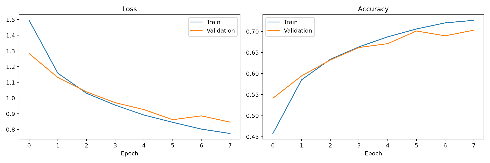
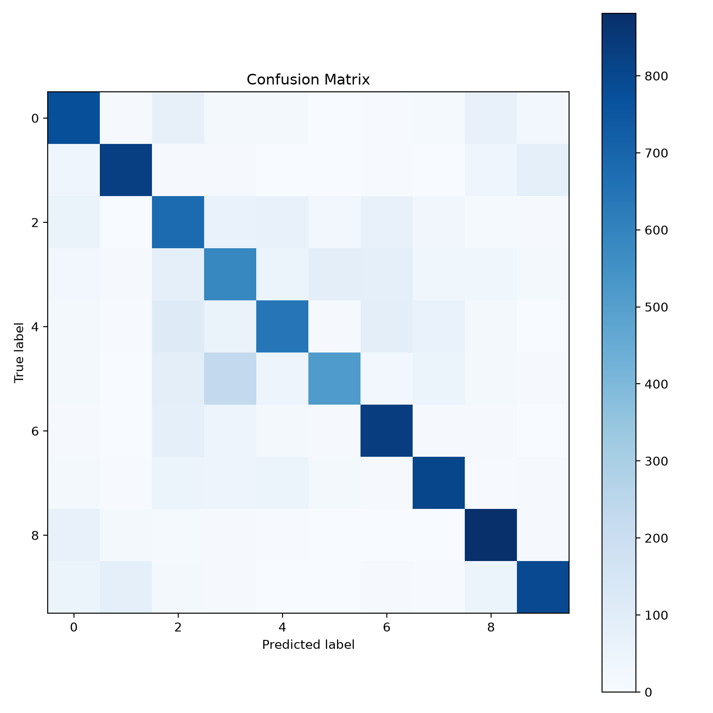
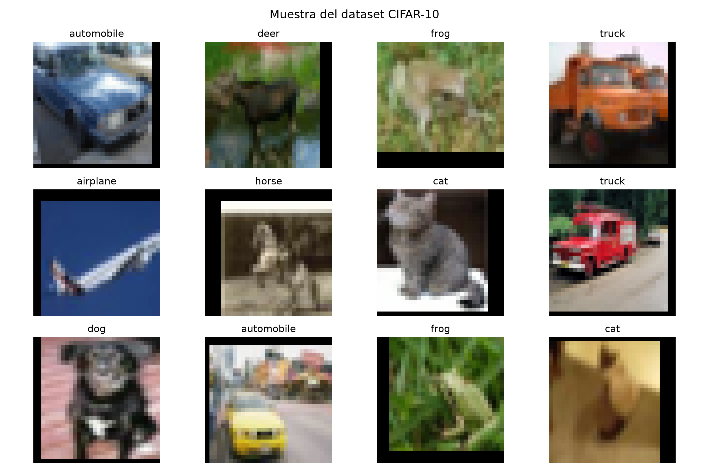

# Evaluación de la segunda unidad: clasificación de imágenes mediante CNN

## 1. Objetivo

Este proyecto desarrolla una solución para la clasificación de imágenes del dataset CIFAR-10 usando una red neuronal convolucional (CNN). El objetivo es cargar, transformar, visualizar y particionar el dataset, además de entrenar una arquitectura CNN y evaluar su rendimiento mediante métricas y curvas de aprendizaje.

## 2. Justificación teórica: por qué una CNN supera a un MLP

Un Perceptrón Multicapa (MLP) toma como entrada una matriz de píxeles aplanada. Para CIFAR-10, cada imagen tiene tamaño 32x32x3 = 3072 valores por muestra; si se aplanan todas las entradas, el número de parámetros del primer nivel dense crece de forma excesiva. Esto produce tres problemas principales: alta complejidad computacional, gran tendencia al sobreajuste y pérdida de la estructura espacial de la imagen.

Las CNNs resuelven estas limitaciones porque explotan propiedades específicas de las imágenes:

- Conexiones locales: cada filtro se enfoca en una pequeña región de la imagen.
- Weight sharing: los mismos pesos se reutilizan a lo largo de toda la imagen, reduciendo la cantidad de parámetros.
- Invariancia espacial: la red puede detectar patrones independientemente de su ubicación en la imagen.
- Pooling: reduce la dimensionalidad y conserva las características más relevantes.

Por estas razones, una CNN es más adecuada para tareas de visión por computador que un MLP.

## 3. Arquitectura propuesta

La red implementada tiene la siguiente especificación:

1. Entrada: tensores 4D con forma [Batch, 3, 32, 32]
2. Bloque convolucional 1:
   - Conv2d(3, 32, kernel_size=3, padding=1)
   - ReLU
   - MaxPool2d(2)
3. Bloque convolucional 2:
   - Conv2d(32, 64, kernel_size=3, padding=1)
   - ReLU
   - MaxPool2d(2)
4. Flatten
5. Fully connected: Linear(64*8*8, 256)
6. ReLU
7. Fully connected: Linear(256, 10)

La salida final tiene 10 logits, uno por cada clase del dataset CIFAR-10.

## 4. Estructura del repositorio

```text
nombres_repositorio/
├── README.md
├── src/
│   ├── dataset.py
│   ├── model.py
│   └── train.py
├── notebooks/
│   └── experiment.ipynb
├── outputs/
│   ├── dataset_samples.png
│   ├── loss_accuracy.png
│   └── confusion_matrix.png
└── data/
    └── CIFAR-10 dataset downloaded automatically
```

## 5. Reproducibilidad

La semilla aplicada al proyecto es:

- Semilla: 76 (dos últimos dígitos de la matrícula)

Esto se usa para controlar la aleatoriedad del shuffle, la partición del conjunto de validación y la inicialización de pesos.

## 6. Resultados y análisis

Resultados registrados con semilla 76, ocho épocas, lote de 64, Adam (tasa de aprendizaje 0.001) y CrossEntropyLoss:

| Época | Pérdida train | Accuracy train | Pérdida validación | Accuracy validación |
|---:|---:|---:|---:|---:|
| 1 | 1.4957 | 0.4576 | 1.2839 | 0.5414 |
| 2 | 1.1588 | 0.5851 | 1.1314 | 0.5944 |
| 3 | 1.0307 | 0.6338 | 1.0394 | 0.6321 |
| 4 | 0.9549 | 0.6634 | 0.9706 | 0.6619 |
| 5 | 0.8919 | 0.6872 | 0.9267 | 0.6710 |
| 6 | 0.8455 | 0.7059 | 0.8623 | 0.7011 |
| 7 | 0.8023 | 0.7204 | 0.8860 | 0.6896 |
| 8 | 0.7742 | 0.7264 | 0.8467 | 0.7030 |

La accuracy final en el conjunto de prueba fue **0.7337 (73.37 %)**. La pérdida de entrenamiento disminuyó en todas las épocas y la accuracy de entrenamiento aumentó. La validación también mejoró en general; la caída temporal de accuracy y el aumento de pérdida en la época 7 sugieren una señal moderada de sobreajuste, aunque ambos valores se recuperan en la época 8. La diferencia final de accuracy entre entrenamiento y validación es 0.0234 (2.34 puntos porcentuales), por lo que no se observa una brecha grande al final del entrenamiento. La matriz de confusión permite inspeccionar qué pares de clases son más difíciles; conviene comentarlos directamente a partir de la figura.

### Curvas de aprendizaje



### Matriz de confusión



### Ejemplos del dataset



## 7. Cómo ejecutar

```bash
cd nombres_repositorio
python src/dataset.py
python src/model.py
python src/train.py
```

## 8. Enlace de repositorio

Repositorio público: [https://github.com/chava454/nombres_repositorio](https://github.com/chava454/nombres_repositorio)

```text
https://github.com/chava454/nombres_repositorio
```
